# EpiDBot User Manual

**AI-Powered Public Health Data Analytics**

Version 2.8.0 | Kwar-AI

---

## Table of Contents

1. [Welcome](#welcome)
2. [Getting Started](#getting-started)
3. [Your First Analysis](#your-first-analysis)
4. [The Chat Interface](#the-chat-interface)
5. [Data Sources](#data-sources)
6. [My Data](#my-data)
7. [Analyzing Data](#analyzing-data)
8. [In-Browser Code Editor (IDE)](#in-browser-code-editor-ide)
9. [Visualizations & Plots](#visualizations--plots)
10. [My Plots](#my-plots)
11. [Projects](#projects)
12. [Blipper — The Data Storytelling Feed](#blipper)
13. [Malaria Atlas](#malaria-atlas)
14. [EpiDBot QGIS Plugin](#epidbot-qgis-plugin)
15. [Reports](#reports)
16. [Sessions](#sessions)
17. [Search](#search)
18. [Knowledge Base](#knowledge-base)
19. [Settings](#settings)
20. [Subscription Plans & Feature Gating](#subscription-plans--feature-gating)
21. [Tips & Best Practices](#tips--best-practices)
22. [Supported Languages](#supported-languages)
23. [Troubleshooting](#troubleshooting)
24. [Glossary](#glossary)

---

## Welcome

EpiDBot is an AI assistant that helps you explore, analyze, and visualize public health data from around the world. Whether you are studying disease trends in Brazil, comparing health indicators across countries, or generating reports for your research, EpiDBot puts powerful epidemiological tools at your fingertips through a simple conversational interface.

### What Can EpiDBot Do?

- **Download and query** public health datasets from Brazil (DATASUS, ANVISA), WHO, ECDC, World Bank, PAHO, and more
- **Run statistical analyses** with temporal, spatial, and demographic breakdowns
- **Generate charts, maps, and plots** automatically from your data — including mindmaps and choropleth maps with smart classification
- **Execute custom Python and SQL code** in a secure sandbox environment
- **Create downloadable PDF reports** with built-in templates (Outbreak, Risk Assessment, Scientific, etc.) and custom CSS themes
- **Upload your own datasets** (CSV, Excel, GeoJSON, and more) for private analysis alongside public data
- **Upload your own report templates** (Markdown + CSS) and share them with other users
- **Share plots and reports on Blipper** — our internal data storytelling feed (like, reply, follow colleagues)
- **Search a knowledge base** of epidemiological documents and references, and explore each collection as a wiki with an interactive knowledge graph
- **Organize your work into projects** — group related sessions, reports, figures, and datasets into shareable workspaces
- **Write and run Python in your browser** with the built-in code editor — no installation required
- **Chat with EpiDBot inside QGIS** — install the [QGIS plugin](https://github.com/Deeplearn-PeD/epidbot-qgis-plugin) to ask questions from your GIS and load GeoJSON answers straight onto the map (see [EpiDBot QGIS Plugin](#epidbot-qgis-plugin))
- **Answer clarifying questions** — when a request is ambiguous, EpiDBot pauses mid-analysis and asks you structured questions
- **Stay up to date** with an optional weekly bilingual newsletter of public-health publications and data updates
- **Remember your conversations** across sessions so you can pick up where you left off

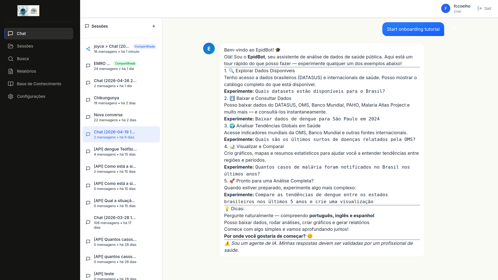

---

## Getting Started

### Creating an Account

EpiDBot is currently in beta testing. To request access:

1. Visit the EpiDBot login page
2. Click the **"Request an invitation"** link in the beta notice banner
3. Fill out the registration form
4. Once approved, you will receive your credentials

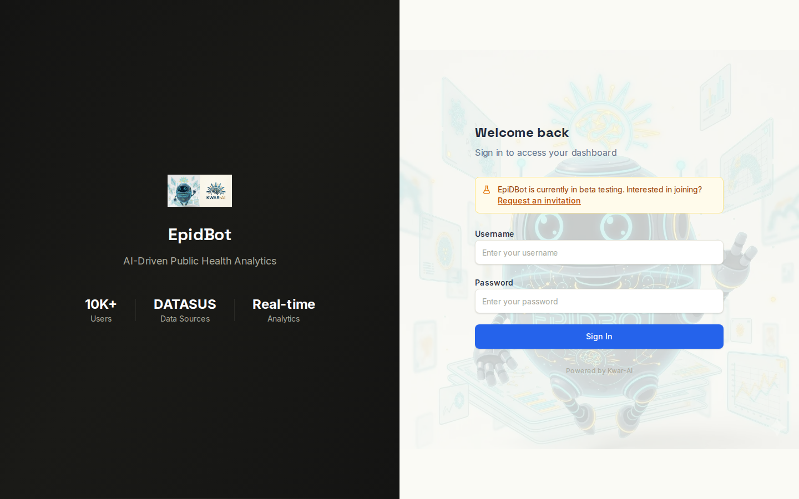

### Logging In

1. Navigate to the EpiDBot login page
2. Enter your **username** and **password**
3. Click **Sign In**

You will be redirected to the chat interface. Your session is secured with JWT authentication.

### Email Verification

After registration, you will receive a verification email. Click the link to activate your account. If you did not receive it, go to **Settings > Profile** and click **Resend verification email**.

### Choosing Your Language

EpiDBot supports five interface languages:

| Language | Code |
|---|---|
| English | `en` |
| Portugues (Brasil) | `pt-BR` |
| Espanol | `es` |
| 简体中文 | `zh-CN` |
| العربية | `ar` |

EpiDBot automatically detects your browser language on your first visit. You can change it at any time in **Settings > Language** (see [Settings](#settings)).

You can also set the **AI response language** independently — for example, using the interface in English while receiving analysis responses in Portuguese.

### Navigation Overview

The sidebar (left side on desktop, hamburger menu on mobile) provides access to all sections:

| Icon | Section | Description |
|---|---|---|
| MessageSquare | **Chat** | Start a new analysis conversation |
| FolderOpen | **Sessions** | Browse and manage past conversations |
| Search | **Search** | Search across messages and code snippets |
| Database | **My Data** | Upload and manage your own datasets |
| FileText | **Reports** | Download generated PDF/Markdown reports |
| Image | **My Plots** | Browse and manage your generated and uploaded plots |
| FolderKanban | **Projects** | Organize sessions, reports, figures, and datasets into workspaces |
| Blipper | **Blipper** | The data storytelling feed |
| BookOpen | **Knowledge Base** | Manage documents and references |
| Star | **Favorites** | Your starred reports, plots and datasets |
| Settings | **Settings** | Profile, API keys, plans, Git integrations, Zotero, voice, newsletter, language preferences |

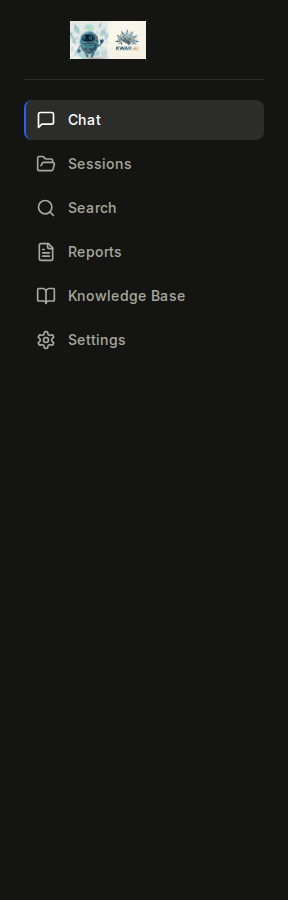

---

## Your First Analysis

When you open the chat for the first time, EpiDBot will greet you with an onboarding tutorial to help you get started. The welcome screen also displays **analysis starter templates** — clickable suggestion cards with common analysis prompts such as "Analyze dengue trends" or "Compare health indicators." Click any card to immediately start an analysis, or type your own question in the input field.

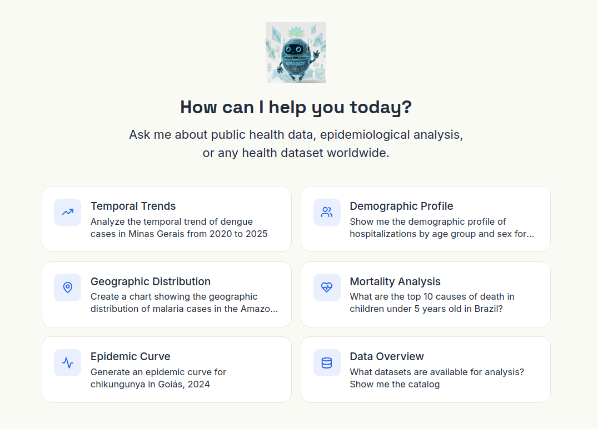

Here is a quick walkthrough:

### Step 1: Explore Available Data

Type a question like:

> What datasets are available?

EpiDBot will list the data sources you can access, including Brazilian DATASUS systems (SINAN, SIM, SINASC), WHO indicators, ECDC surveillance data, and more.

### Step 2: Download Data

Ask EpiDBot to download a specific dataset:

> Download dengue data for Sao Paulo in 2023

EpiDBot will fetch the data, store it as a parquet file, and confirm when it is ready for analysis.

### Step 3: Analyze and Visualize

> Show me a bar chart of dengue cases by month

EpiDBot will query the data, generate the chart, and display it directly in the chat.

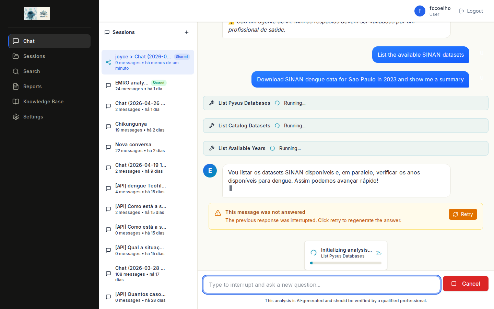

---

## The Chat Interface

The chat is your primary workspace in EpiDBot. It is a full-featured conversational interface with real-time streaming, tool execution feedback, and rich content rendering.

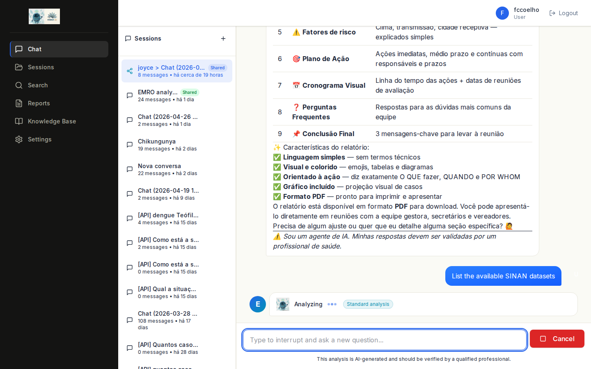

### Sending Messages

- Type your message in the input field at the bottom
- Press **Enter** to send (Shift+Enter for a new line)
- During streaming, you can type a new message to interrupt and redirect the analysis
- Use **voice input** by clicking the microphone button inside the input field. Speak naturally and your words will be transcribed in real-time. Click the microphone again to stop recording. Voice input uses your browser's built-in speech recognition.

### Streaming Responses

EpiDBot streams responses in real-time. You will see:

1. **Analyzing animation** — the EpiDBot avatar pulses with a complexity indicator:
   - "Quick answer" — simple factual questions
   - "Standard analysis" — single data lookups
   - "Detailed analysis" — multi-step analysis with plots
   - "Deep analysis" — complex modeling or cross-dataset work

2. **Tool execution** — when EpiDBot uses a tool (downloading data, running SQL, generating a plot), you will see:
   - The tool name and a progress bar
   - Elapsed time counter
   - Status messages ("Processing...", "Analyzing data...")
   - Expandable code preview showing what code is running

3. **Response text** — the answer streams in character by character with a typing cursor

### Interrupting a Response

While EpiDBot is processing or streaming, you can:

- Type a new message to **interrupt and redirect** the analysis
- Click the **Cancel** button (red square icon) to stop the current response entirely

When you interrupt, any partial results are saved, and a new conversation turn begins with your new message.

### Answering Clarifying Questions

Sometimes a request can be interpreted in more than one way. Instead of guessing, EpiDBot can pause mid-analysis and show a **question card** with one or more structured questions (up to four at once). Each question has:

- A short **header** describing the topic
- **Option buttons** — single-choice (round buttons) or "select all that apply" (square checkboxes), each with a brief description
- A **free-text field** to type your own answer if none of the options fit

Select your answers for every question and click **Submit answers** — EpiDBot resumes the analysis using them. If you do not respond within about five minutes, EpiDBot continues with sensible defaults.

### Avatars and Sender Attribution

Every user message displays the **sender's avatar** next to it. In shared sessions, each message shows the avatar of the person who actually wrote it — so when colleagues contribute to a shared conversation, you can see at a glance who said what. Users without a profile photo are shown with their initials.

### Editing Messages

You can edit your last sent message by hovering over it and clicking the **pencil icon** that appears below. Edit the text in the inline editor and press **Enter** to resubmit. EpiDBot will discard the previous response and generate a new one based on your edited message. Press **Escape** to cancel editing.

### Rich Content in Messages

EpiDBot renders responses with full formatting support:

- **Markdown** — headings, bold, italic, lists, links
- **Tables** — sortable data tables with styled headers
- **Code blocks** — syntax-highlighted with a dark theme; hover to reveal a **copy button** that copies the code to your clipboard
- **Math/LaTeX** — mathematical notation rendered with KaTeX
- **Images and plots** — charts and maps displayed inline
- **Data tables** — hover to reveal **Copy as TSV** and **Download CSV** buttons for exporting table data

### Copying Messages

Hover over any assistant message to reveal a **copy button** that copies the full response text to your clipboard.

### Unanswered Messages

If a message was sent but never answered (e.g., due to a connection issue), an amber warning banner appears with a **Retry** button.

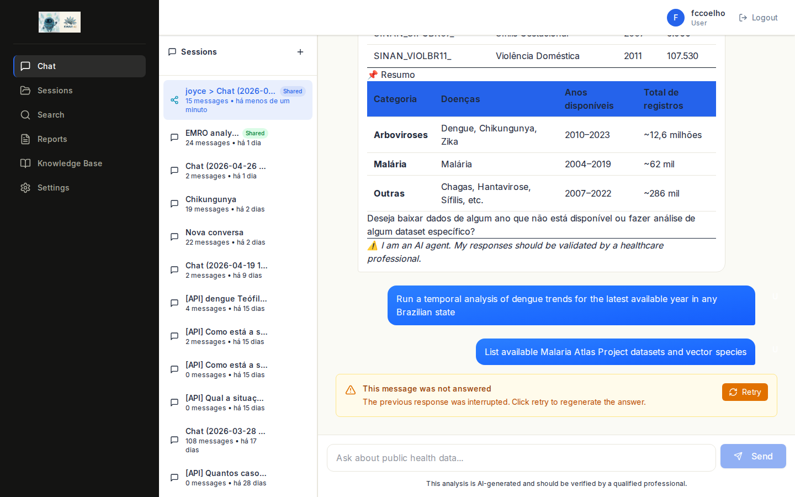

### Quota Enforcement

Before sending a message, EpiDBot checks your token quota. If you have exceeded your plan limit, an amber banner informs you of the quota status and when your quota resets.

### Exporting Chat as PDF

Click the **Export PDF** button at the top of the chat to download the entire conversation as a formatted PDF document. This includes all messages, plots (embedded as images), tables, and formatting. You can also use the keyboard shortcut `Ctrl+Shift+E`.

### Message Feedback

After EpiDBot responds, you can rate the quality of the answer using the **thumbs up** or **thumbs down** buttons that appear when hovering over an assistant message. Click the same rating again to remove it. This feedback helps improve the system over time.

### Keyboard Shortcuts

| Shortcut | Action |
|---|---|
| `Ctrl+K` | Open search |
| `Ctrl+N` | Start new session |
| `Ctrl+Shift+E` | Export chat as PDF |
| `Escape` | Close lightbox / cancel edit |

---

## Data Sources

EpiDBot connects to a wide range of public health data sources worldwide. Ask naturally — EpiDBot will automatically select the right source for your query.

### Brazilian Health Data (DATASUS)

| System | Description |
|---|---|
| **SINAN** | Disease notification system (dengue, Zika, chikungunya, tuberculosis, HIV, etc.) |
| **SIM** | Mortality information system |
| **SINASC** | Live birth information system |
| **SIH/SIA** | Hospital and outpatient information systems |
| **SINAN-NET** | National notifiable diseases network |

You can query data by state, year, municipality, and disease. Example queries:

> Download SINAN dengue data for Rio de Janeiro in 2023

> What is the mortality rate for tuberculosis in the Northeast region?

> List all available datasets for 2024

### International Data Sources

!!! note "Plan requirement"
    The international data sources below (ECDC, World Bank, PAHO, HealthData.gov, Mosqlimate, ANVISA, Pathoplexus, Malaria Atlas, GADM, GBIF, Eurostat, NZ Health) require the **Pro** plan or higher. The core Brazilian DATASUS systems and WHO indicators are available on **all plans**, including Free. See [Subscription Plans & Feature Gating](#subscription-plans--feature-gating).

| Source | Coverage | What You Can Get |
|---|---|---|
| **WHO** (Global Health Observatory) | Global | Health indicators, disease outbreaks, country profiles |
| **ECDC** (European Centre for Disease Prevention and Control) | Europe | Surveillance data, disease reports, epidemiological updates |
| **World Bank** | Global | Health expenditure, life expectancy, immunization rates, demographic indicators |
| **PAHO** (Pan American Health Organization) | Americas | Immunization coverage, malaria/dengue data, health indicators |
| **HealthData.gov** | United States | Hospital capacity, COVID metrics, vaccination data, nursing home data |
| **Malaria Atlas Project** | Global | Plasmodium prevalence, vector occurrence, administrative boundaries, raster surfaces |
| **Pathoplexus** | Global | Genomic sequence counts for organisms of interest |

### Mosqlimate (Brazilian Climate & Epidemiological Data)

- **InfoDengue** — epidemiological reports for dengue and other arboviruses
- **Climate data** — daily and weekly weather observations
- **Mosquito occurrence** — *Aedes aegypti* and *Aedes albopictus* occurrence records
- **EpiScanner** — automated epidemiological surveillance data
- **Prediction models** — browse registered forecasting models for mosquito-borne diseases
- **Predictions** — view submitted predictions and forecasts from the model registry

### Geographic Data

- **GADM** — administrative boundaries for any country (states, municipalities, regions)
- **Brazilian municipalities** — IBGE codes, coordinates, state-level listings

### More Specialized Sources

- **ANVISA** (Brazilian Health Regulatory Agency) — 15 open datasets covering medicines, food safety, cosmetics, pharmacovigilance, and more. Data is accessed via Brazil's federal open data portal (dados.gov.br).
- **ECDC Atlas of Infectious Diseases** — 59 diseases across 8 categories (vaccine-preventable, food/waterborne, STIs, vector-borne, respiratory, zoonotic) with antimicrobial resistance data for all EU/EEA countries.
- **New Zealand Health Data** — mortality records, hospital events, life tables, and immunisation coverage from New Zealand's Ministry of Health.

### Example Queries

> What are the latest WHO disease outbreaks?

> Compare life expectancy across South American countries using World Bank data

> Download malaria vector occurrence data for Kenya

> List all ECDC surveillance datasets available

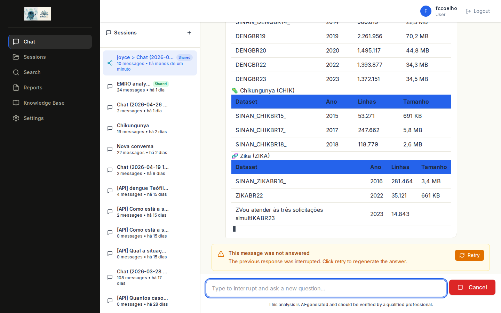

---

## My Data

The **My Data** page lets you upload, manage, and preview your own datasets for private analysis alongside public data sources.

### Uploading Datasets

1. Navigate to **My Data** in the sidebar
2. Click the **upload area** or drag and drop a file
3. Optionally add a **description** for your dataset
4. Supported formats: **CSV, ODS, XLSX, GeoJSON, Shapefile (.zip), GeoPackage** (max 50 MB per file)

Uploaded datasets are stored privately under your account and can be queried in the chat just like public data.

!!! note "Plan limits"
    The number of uploaded datasets and total storage depend on your plan — Free: 1 dataset / 100 MB, Pro: 10 / 5 GB, Max: 50 / 25 GB, Team: unlimited. See [Subscription Plans & Feature Gating](#subscription-plans--feature-gating).

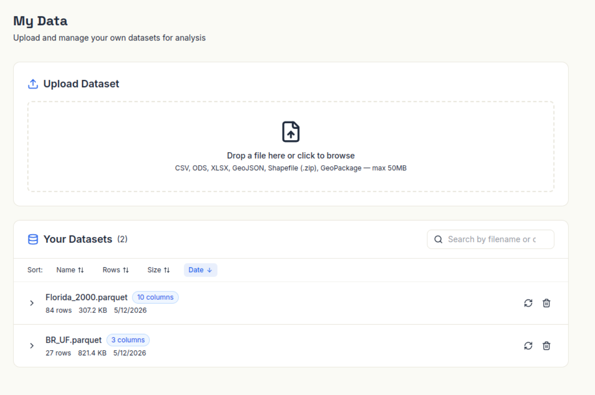

### Browsing and Searching

The dataset list shows each file with its name, row count, file size, and upload date. Use the **search bar** to filter by filename or description. Sort by **Name**, **Rows**, **Size**, or **Date** using the sort controls.

### Previewing Data

Click a dataset to expand it. Two tabs are available:

- **Schema** — shows column names, data types, and nullable flags
- **Preview** — displays the first 10 rows of data in a scrollable table (up to 15 columns shown, with horizontal scroll for wider datasets)

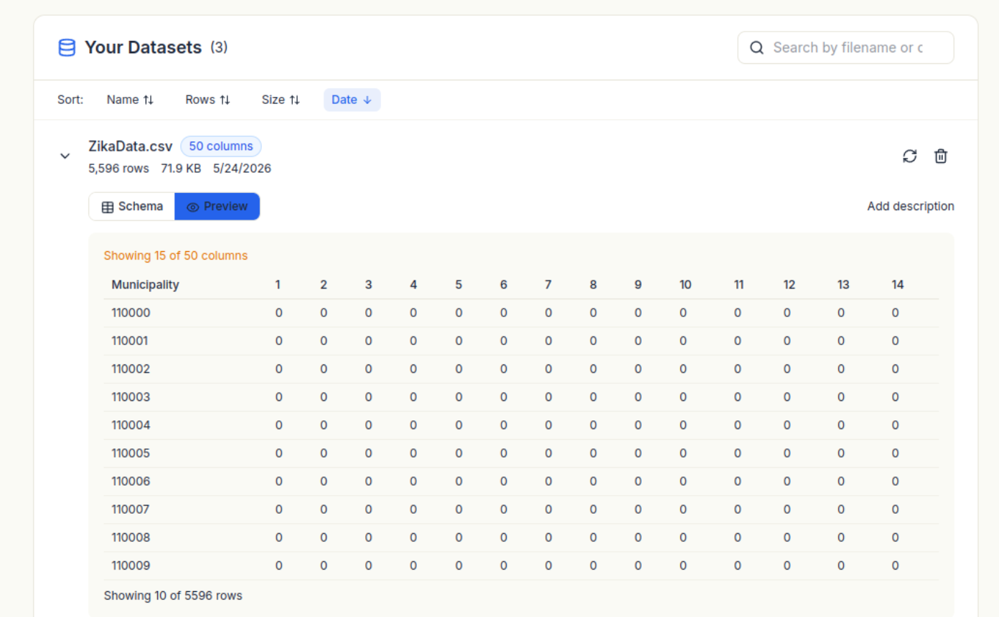

### Managing Datasets

- **Edit description** — click the description text to add or modify a description
- **Refresh** — update the dataset metadata
- **Delete** — remove the dataset (with confirmation)

---

## Analyzing Data

EpiDBot provides a comprehensive suite of analysis tools. Once data is downloaded or available in the catalog, you can ask for any type of analysis.

### Statistical Analysis

| Analysis Type | Example Query |
|---|---|
| Temporal analysis | "Show me the trend of dengue cases over time in Sao Paulo" |
| Spatial analysis | "Which municipalities have the highest Zika incidence?" |
| Demographic analysis | "Break down tuberculosis cases by age group and sex" |
| Data quality report | "Generate a data quality report for this dataset" |
| Cross-dataset comparison | "Compare dengue and Zika trends in the same region" |

### SQL Queries

You can ask EpiDBot to run SQL queries directly on downloaded data:

> Query the dengue dataset to find the top 10 municipalities by case count in 2023

EpiDBot translates your request into DuckDB SQL and returns the results as a formatted table.

### Sandbox Code Execution

For advanced analysis, EpiDBot can execute custom Python or SQL code in an isolated sandbox environment:

> Run a Python analysis to calculate the rolling 7-day average of dengue cases

The sandbox includes common scientific libraries: pandas, numpy, matplotlib, seaborn, scikit-learn, and more.

### Actuarial Modeling

!!! note "Plan requirement"
    Actuarial modeling requires the **Pro** plan or higher. See [Subscription Plans & Feature Gating](#subscription-plans--feature-gating).

EpiDBot includes a suite of actuarial modeling tools commonly used in insurance and risk analysis, driven entirely by natural language:

| Capability | What You Get |
|---|---|
| **Loss reserving** | Chain-ladder, Bornhuetter-Ferguson, and Cape Cod methods on run-off triangles, with per-period reserves, IBNR estimates, Mack standard errors, and development plots |
| **Claim modeling** | Fit claim severity/frequency distributions by maximum likelihood, with goodness-of-fit tests and pricing of deductibles and limits (VaR/TVaR) |
| **Portfolio aggregation** | Combine component losses into a full portfolio loss distribution (FFT, Panjer recursion, Monte Carlo) and price reinsurance layers (excess-of-loss, stop-loss, quota share) |
| **Lifetime modeling** | Fit parametric survival/mortality models (exponential, Weibull, log-normal, and more, optionally with covariates), with life expectancy, median lifetime, survival, and hazard plots |

Example query:

> Using this run-off triangle of claim payments, estimate the IBNR reserves with the chain-ladder method and show the development plot

### Exporting Results

> Export the analysis results as a CSV file

EpiDBot supports exporting query results in **CSV, JSON, Excel, and Parquet** formats. Ask naturally:

> Export these results as an Excel file

> Save the data as a Parquet file

Exported files are downloaded directly to your computer.

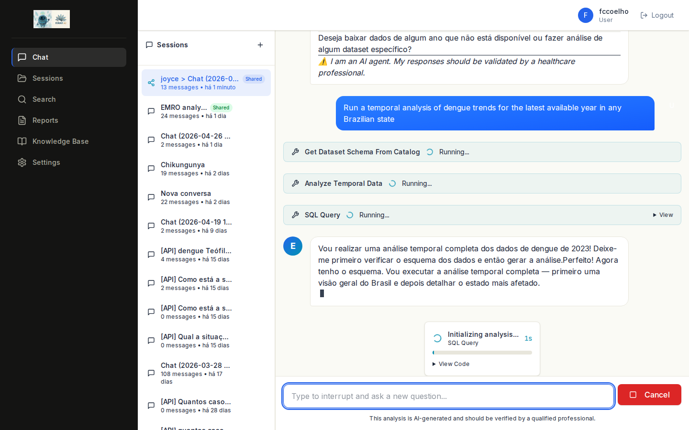

---

## In-Browser Code Editor (IDE)

The IDE lets you write and run Python **entirely in your browser** — no installation, no server round-trip. It is powered by Pyodide (Python compiled to WebAssembly) and comes with **numpy, pandas, matplotlib, and DuckDB** preloaded. Extra pure-Python packages can be installed on the fly with the built-in package installer (micropip).

### Opening the IDE

- **Search page** — click **Edit & Run** on any saved code snippet
- **My Plots** — click **Edit & Run** on a plot card to open an editable copy of its code
- **Reports** — open a report's **Analysis code** panel and click **Open in IDE** next to any snippet

### Writing and Running Code

- The editor provides Python syntax highlighting; click **Run** to execute
- Output (text, figures, DataFrames) appears in the output panel below, Jupyter-style
- Drag the **splitter** between editor and output panel to resize them (double-click resets the split)
- Execution is limited to **30 seconds** per run — for longer jobs, download the code and run it locally

### Loading Data

- Click **Load Data** to browse catalog datasets and insert the corresponding `load_dataset(...)` call into your code
- Files under the server's `/data/` directory — including your own private uploads — are transparently available at their usual paths, so `pandas.read_parquet(...)`, `open(...)`, and DuckDB queries work as-is (files up to 300 MB)

### Saving Snippets

- Click **Save** to store your code as a reusable snippet (searchable on the Search page)
- Snippets keep a **version history** you can browse and restore
- A snippet being edited is **locked** for 30 minutes so collaborators cannot overwrite your work in parallel

The IDE is available on **all plans**.

---

## Visualizations & Plots

EpiDBot can generate a wide variety of visualizations automatically. Just describe what you want to see.

### Chart Types

| Chart Type | Example |
|---|---|
| Bar chart | "Show a bar chart of cases by state" |
| Line chart | "Plot the temporal trend of malaria cases" |
| Choropleth map | "Create a map of dengue incidence by municipality" |
| Histogram | "Show the age distribution of tuberculosis patients" |
| Box plot | "Compare the distribution of cases across regions" |
| Bubble chart | "Plot GDP vs. life expectancy with population as bubble size" |
| Stacked bar | "Show disease cases stacked by age group" |
| Raster/map | "Render the malaria prevalence raster for Africa" |
| Diagram/flowchart | "Create a flowchart showing the epidemiological surveillance workflow" |

### Working with Plots

- Plots are displayed inline in the chat
- All plots are saved and can be referenced later
- You can ask EpiDBot to adjust colors, labels, or chart type
- Use **"List available plots"** to see previously generated visualizations

### Example Queries

> Compare dengue cases across Brazilian states for the last 5 years and create a visualization

> Generate a choropleth map of HIV incidence by municipality in Rio de Janeiro

> Plot a time series of WHO-reported cholera outbreaks

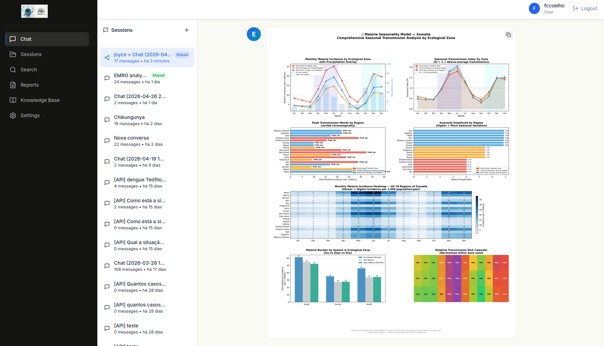

---

## My Plots

The **My Plots** page provides a gallery of all your generated and uploaded visualizations in one place.

### Accessing My Plots

Click **My Plots** in the sidebar to browse all your plots displayed as a card grid.

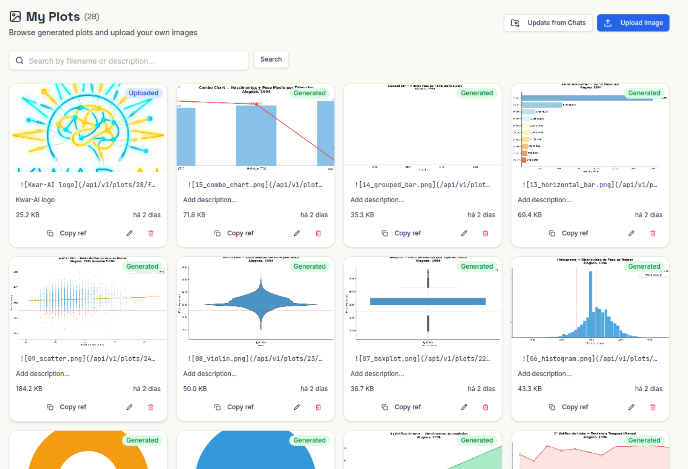

### Browsing Plots

Each plot card shows a thumbnail, filename, and description. Use the **search bar** to filter plots by filename or description.

### Lightbox Preview

Click any plot image to open a **full-size lightbox preview** that scales to fit your browser window. Press **Escape** or click outside the image to close.

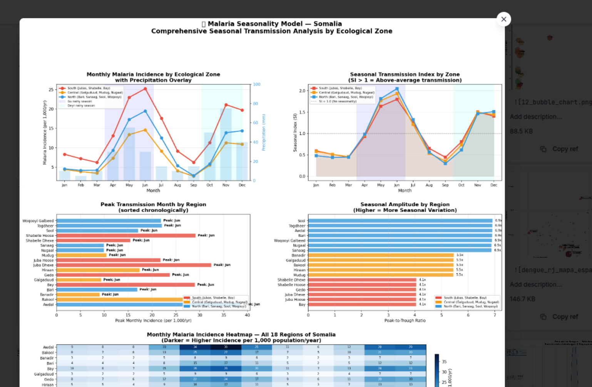

### Managing Plots

- **Copy reference** — copy the markdown image reference for use in chat or reports
- **Edit & Run** — open the plot's code in the in-browser IDE to tweak and regenerate it
- **Add to project** — link the plot to one of your [projects](#projects)
- **Edit description** — add or modify the plot description
- **Delete** — remove the plot (with confirmation)
- **Upload your own images** (PNG, JPG, WebP, GIF, SVG)
- **Sync from chats** — click the sync button to scan your chat history and register any plots not yet in the gallery

---

## Projects

Projects are **transversal workspaces** that link your existing sessions, reports, figures, and datasets around a common theme — for example, "Dengue Recife 2026". Items stay where they live (a report remains on the Reports page, a figure in My Plots); the project simply gathers them in one place. Projects are available on **all plans**.

### Creating a Project

1. Click **Projects** in the sidebar
2. Click **New project**, enter a **name** and an optional **description**, and click **Create**

You can also manage projects from the chat — just ask:

> Create a project called "Dengue Recife 2026" and add my latest dengue report to it

### Adding Items

On the **My Plots**, **Reports**, **My Data**, and **Sessions** pages, click the **Add to project** button on any card, then:

- Pick one of your projects from the list, or
- Type a new project name and click **Create & add**

### Browsing Projects

Each project card shows the name, description, and **per-type item counts** (sessions, reports, figures, datasets), plus a "Shared by" badge when the project was shared with you. Open a project to see four panels:

- **Sessions** — linked conversations; click to resume
- **Reports** — linked reports
- **Figures** — linked plots with thumbnail previews
- **Datasets** — linked datasets

Every item links back to its original page and can be unlinked with the trash button (owners and editors only).

### Sharing Projects

Project owners can click **Share** and grant **Viewer** or **Editor** access to other users. Sharing a project grants recipients read access to the items it contains; editing an individual item still requires permission on that item.

---

## Blipper — The Data Storytelling Feed

Blipper is EpiDBot's internal social feed that lets you share plots, reports, and insights directly from your analyses. Think of it as a Twitter-like feed built for public health data storytelling.

### Sharing Content to Blipper

You can share content to Blipper from:

- **Chat messages** — click the share button on any message bubble containing a figure or analysis
- **My Plots** — click the **Send to Blipper** button on any plot card

### The Feed

The Blipper feed shows posts from people you follow (Home tab) and all public posts (Explore tab):

- **Rich attachments** — shared plots appear as thumbnail images; click to open a full-screen lightbox for detailed viewing
- **Reports** — shared reports appear as clickable links
- **Interact** — like posts, reply to discussions, and follow colleagues
- **User profiles** — click on any username to see their full profile and posting history
- **Notifications** — get notified when someone likes your post, replies, or follows you

### Post Composer

When you share from chat or plots, a draft is pre-loaded into the post composer with the attachment and a suggested caption. You can edit the text, add mentions (`@username`), and choose whether to post from the "Share to Blipper" screen.

---

## Malaria Atlas

EpiDBot includes dedicated tools for accessing the Malaria Atlas Project (MAP) database, providing global data on malaria prevalence, mosquito vectors, and geographic boundaries.

### Available Data

| Data Type | Description |
|---|---|
| Plasmodium prevalence surveys | Point-in-time parasite rate surveys across the world |
| Vector occurrence data | Geolocated records of *Anopheles* mosquito species |
| Administrative boundaries | Shapefiles for countries, provinces, and districts |
| Raster surfaces | Gridded prevalence estimates and risk maps |
| WHO AFRO admin-level data | Administrative-level malaria indicators via API |

### Example Queries

> Download malaria prevalence survey data for Nigeria

> List all available Anopheles vector species

> Download administrative boundaries for Tanzania

> Show me the malaria prevalence raster surface for Southeast Asia

> Get malaria indicator data for Mozambique from WHO AFRO

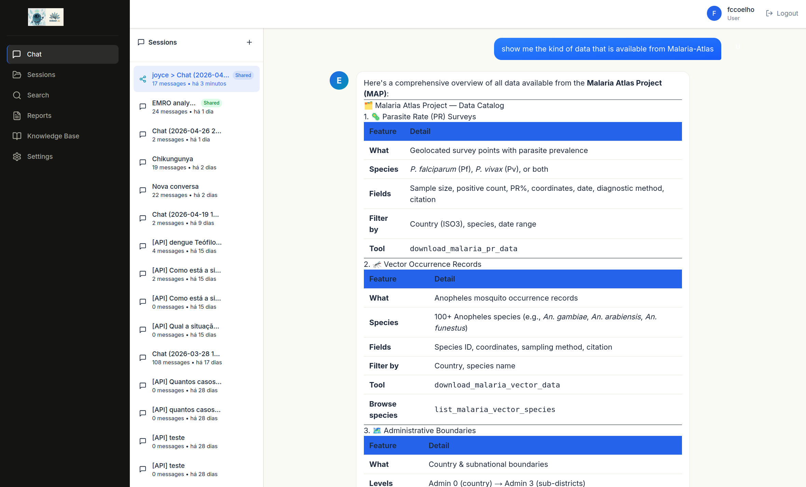

---

## EpiDBot QGIS Plugin

The **EpiDBot QGIS plugin** brings the EpiDBot chat directly into [QGIS](https://qgis.org/), the free open-source geographic information system. Ask epidemiological questions, generate charts, and load geospatial results onto your map — all without leaving your GIS workflow.

The plugin talks to your EpiDBot account over the same REST API as the web interface, so sessions, plots, and quotas stay in sync. It is developed open source at [github.com/Deeplearn-PeD/epidbot-qgis-plugin](https://github.com/Deeplearn-PeD/epidbot-qgis-plugin) under the GPL-2.0-or-later license.

### Requirements

- **QGIS 3.28** or newer (Windows, macOS, or Linux)
- An EpiDBot account on a paid plan (**Pro, Max or Team**) — API keys are included in all of them
- A personal **EpiDBot API key** — create one in the EpiDBot web UI under **Settings > API Keys** (see [API Keys](#api-keys))
- An internet connection to the EpiDBot server

The plugin is published in the **official QGIS plugin repository** as [EpidBot](https://plugins.qgis.org/plugins/epidbot/) (plugin ID `6764`).

### Installing the Plugin

**From the official plugin repository (recommended):**

1. In QGIS, open **Plugins > Manage and Install Plugins**
2. Search for **EpidBot** — or open the [plugin page](https://plugins.qgis.org/plugins/epidbot/) in a browser
3. Click **Install Plugin**
4. Open the **EpiDBot Chat** panel from the QGIS toolbar (or **View > Panels**)

Installed this way, the plugin is updated by the QGIS plugin manager itself.

**From a ZIP package** — only when you need a version newer than the one already published:

1. Download the latest plugin ZIP: [epidbot.zip](https://github.com/Deeplearn-PeD/epidbot-qgis-plugin/releases/latest/download/epidbot.zip) — this link always points at the most recent release
2. In QGIS, open **Plugins > Manage and Install Plugins > Install from ZIP**
3. Select the downloaded file and click **Install Plugin**
4. Open the **EpiDBot Chat** panel from the QGIS toolbar

### Configuring the Plugin

Click the **⚙ (gear) button** in the chat panel to open the settings:

| Setting | Meaning |
|---|---|
| **Server URL** | EpiDBot API base URL — pre-filled with the default `https://api.epidbot.kwar-ai.com.br` |
| **API key** | Your personal EpiDBot API key, sent as an `X-API-Key` header on every request. Stored in the system keyring when the optional `keyring` package is available |
| **Answer language** | Language of the AI responses: `en` or `pt-BR` |
| **Status poll interval** | Seconds between job-status polls (default 1.5 s) |

### Chatting from QGIS

The dockable **EpiDBot Chat** panel works like the web chat:

- Type a question and press Enter — answers render with Markdown formatting, tables, and inline chart thumbnails
- Pick an **existing session** from the session selector, start a **new one**, or let the server auto-create one; switching sessions reloads the history, including plots
- **Export a conversation** to a Markdown file
- The panel UI is available in **English and Brazilian Portuguese**, and chat requests run on a background thread so QGIS stays responsive while EpiDBot works

### Map Integration

This is where the plugin shines — EpiDBot understands your QGIS project and can feed results back onto the map:

- **Map context injection** — every prompt automatically includes your active layers (with field names, sample values, and current selections), the canvas extent (EPSG:4326), and the project CRS, so EpiDBot knows what you are looking at
- **Spatial prompts** — one-click toolbar actions let you ask about the **current map extent** or the **features you have selected**
- **"Add to map"** — GeoJSON blocks and dataset URLs in answers become styled map layers on the canvas with a single click

Example prompts:

> Map the dengue incidence of the municipalities currently loaded in my project

> What is the total population of the selected municipalities?

### Working with Plots

Every chart EpiDBot generates in the plugin offers three actions:

- **Save to disk** — export the image file
- **Open in image viewer**
- **Embed in print layout** — add the plot to an *"EpidBot Plots"* print layout for map compositions

### Coming Soon

Planned features include a **dataset catalog browser** (browse EpiDBot datasets and load them directly as QGIS layers) and document uploads from QGIS — keep an eye on the [releases page](https://github.com/Deeplearn-PeD/epidbot-qgis-plugin/releases).

---

## Reports

EpiDBot can generate comprehensive PDF and Markdown reports from your analyses, using built-in templates with distinct visual styles.

### Report Templates

EpiDBot ships with **6 built-in report templates**, each with its own structure and colour theme:

| Template | Best for | Style |
|---|---|---|
| **Outbreak Investigation** | Disease outbreak reports | Cyan/teal accent |
| **Rapid Risk Assessment** | Risk scoring and confidence assessment | Red/orange risk indicators |
| **Epidemiological Summary** | Operational surveillance summaries | Green accent, data-forward |
| **Scientific Report** | Academic publications | Black/serif, formal |
| **Field Investigation** | Short-term field investigation reports | Blue accent, narrative style |
| **Technical Report** | General technical/analytical reports | Purple accent, code-friendly |

You can also **upload your own custom templates** (Markdown structure + CSS theme) and share them with other users. Templates are managed on the Reports page — click the **Templates** header to expand the template gallery.

Generated PDFs include the Kwar-AI logo in the footer alongside the "Generated by EpidBot" text.

### Generating a Report

Ask EpiDBot to create a report with a specific template:

> Generate a structured report on dengue trends in Brazil for 2023 using the Outbreak Investigation template

> Create a rapid risk assessment for the current chikungunya outbreak

EpiDBot will compile the analysis results, plots, and interpretations into a formatted document using your selected template.

### Downloading Reports

1. Navigate to **Reports** in the sidebar
2. Browse your generated reports
3. Click the **Download PDF** or **Download Markdown** icon

Each report card shows the title, type (analysis, summary, data quality, comparison), creation date, file size, and number of images. The card toolbar also provides **Edit**, **Add to project**, **Improve with AI**, **Download LaTeX (ZIP)**, **BibTeX** (when the report has references), and share actions.

### Managing Reports

- **Search** reports by title or type
- **Delete** reports you no longer need (with confirmation)
- **Version history** — click a report to open the editor, where you can view all past versions and restore a previous version *(Max plan)*
- **Edit and regenerate** — modify the markdown content and regenerate the PDF
- Admins can toggle between **"All Reports"** and **"My Reports"** to view all users' reports

### LaTeX Export

!!! note "Plan requirement"
    LaTeX export requires the **Max** plan.

Click the **Download LaTeX (ZIP)** button on a report card to get a ready-to-compile archive containing:

- The **`.tex` source** — open it directly in Overleaf or any LaTeX editor
- **`figures/`** — all figures referenced by the report (converted to PNG where needed)
- **`references.bib`** — a BibTeX bibliography; in-text citations are rewritten to proper `\cite{...}` commands
- **`code/`** — every analysis snippet linked to the report, with descriptive names and a README

### Scientific Manuscripts

!!! note "Plan requirement"
    The scientific manuscript agent requires the **Max** plan.

Ask EpiDBot to write a full manuscript and it launches a multi-step AI pipeline (plan, analyze, write, reference, review) that produces a publication-oriented IMRaD report:

> Write a scientific manuscript on dengue trends in Rio de Janeiro from 2020 to 2024 using SINAN data

Manuscript generation runs as a background job (typically 10–15 minutes) — you can keep chatting meanwhile, and a **"Manuscript ready"** banner with a link appears when it is done. Manuscripts include:

- A **publication-grade Methods section** with the full data-provenance flow, formal specification of every model and metric, and a reproducibility statement
- **Numbered equations** that can be referenced in the text, on screen, in the PDF, and in the LaTeX export
- An **Analysis code panel** on the report page listing every snippet used, each with **Open in IDE** and **Copy** actions

### Plan Limits for Reports

- **Free** — up to **3 reports per month**; downloaded PDFs carry a light "FREE PLAN" watermark
- **Pro** — unlimited reports, no watermark
- **Report sharing** requires **Pro**; **co-authoring**, **Zenodo publishing**, **version history**, **LaTeX export**, and **Overleaf push** require **Max**

See [Subscription Plans & Feature Gating](#subscription-plans--feature-gating) for the full matrix.

### Sharing Reports

Share reports with other EpiDBot users:

1. Click the **share icon** on a report card
2. Enter a **username** and choose **Can view** or **Can edit** permission
3. Shared reports appear in the recipient's Reports page with a shared badge

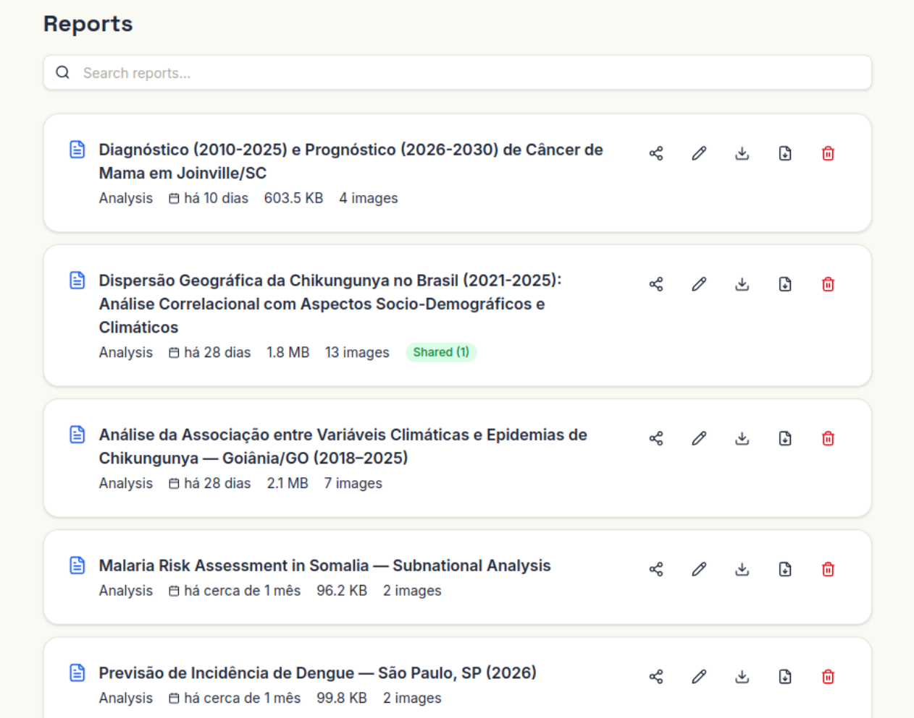

---

## Sessions

Every chat conversation is automatically saved as a **session**. You can view, resume, rename, share, and delete sessions.

### Accessing Sessions

Click **Sessions** in the sidebar to see all your conversations.

The session sidebar in the chat view can be **collapsed** by clicking the collapse button in its header. This gives you more space for the chat. Click the expand button to bring it back.

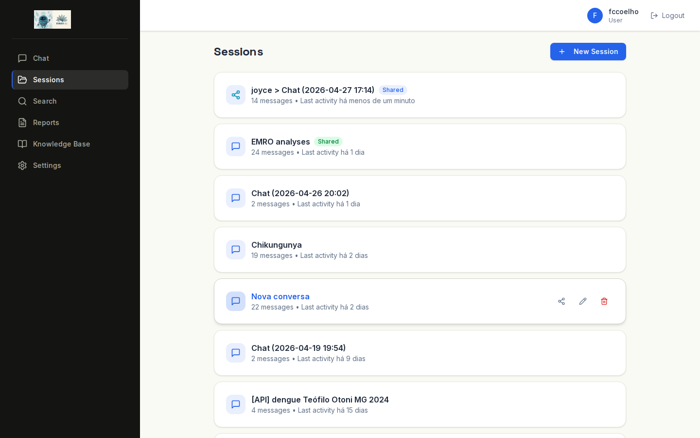

### Session Cards

Each session card displays:

- Session name
- Message count
- Last activity time (e.g., "2 hours ago")
- **Shared** badge if the session has been shared with or by others

### Managing Sessions

| Action | How |
|---|---|
| Create new session | Click the **+** button, type a name, press Enter |
| Rename a session | Click the **pencil** icon on the session card |
| Delete a session | Click the **trash** icon (confirms before deleting) |
| Resume a session | Click the session card to open the conversation |

### Sharing Sessions

You can share sessions with other EpiDBot users:

!!! note "Plan limits"
    The **Free** plan allows **1 active share link**; **Pro** and above have unlimited share links. See [Subscription Plans & Feature Gating](#subscription-plans--feature-gating).

1. Click the **share** icon on a session card
2. Type a **username** in the dialog (autocomplete will suggest matches)
3. Choose a permission level:
   - **Can view** — read-only access to the conversation
   - **Can edit** — full access to continue the conversation
4. Click **Share**

To revoke access, open the share dialog and click **Revoke access** next to the user's name.

### Shared Session Restrictions

- Sessions shared with you as "read-only" cannot be modified — the input area is replaced with a lock icon and message
- Sessions received from others cannot be renamed, deleted, or re-shared
- When someone shares a session with you, a blue notification banner appears at the top of your chat

---

## Search

The search page lets you find content across all your conversations and saved code snippets, with filters to narrow results by type.

### Searching

1. Navigate to **Search** in the sidebar
2. Enter your search query in the text field
3. Use the **type selector** tabs to filter results:
   - **All** — search both chat messages and code snippets
   - **Sessions** — search only chat conversation history
   - **Code Snippets** — search only saved analysis code
4. Optionally filter by **session** or **date range**
5. Results appear in two categories:
   - **Code Snippets** — reusable code with language badges and download buttons
   - **Chat Messages** — matching messages with content preview and timestamps

### Search Results

- Click any chat message result to navigate directly to that conversation
- Code snippets can be expanded to view the full source code
- Export individual messages as Markdown

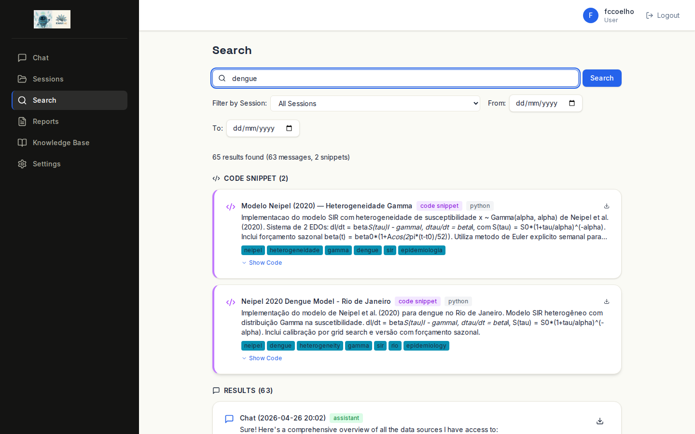

---

## Knowledge Base

The knowledge base stores documents and references that EpiDBot can search when answering your questions. It supports semantic search across embedded documents.

### Checking Status

The knowledge base status card shows whether the service is healthy and displays the current version. Click **Check Status** to refresh.

### Searching the Knowledge Base

1. Enter a search query in the **search field**
2. Optionally select a **collection** to narrow results
3. Results show: document name, relevance score, collection, and content preview

### Adding Sources

!!! note "Administrator only"
    Adding sources to the knowledge base (web pages, text, document uploads, and Ministry of Health publications) is restricted to **administrators**. Regular users have read-only access: searching the knowledge base and browsing collections, sources, and wikis is available on all plans.

Administrators can add content to the knowledge base in three ways:

| Method | What to Do |
|---|---|
| **Web Page** | Paste a URL and click "Add Web Page" — EpiDBot will fetch, extract, and embed the content |
| **Text Content** | Provide a document name and paste the text content |
| **Upload Document** | Upload a file (.pdf, .txt, .md, .doc, .docx) |

When adding content, select a target **collection** (or use the default collections: datasus, epidemiology, methodology).

### Managing Collections

The right panel shows:

- **Collections** — all collections with their document counts
- **Sources** — all documents with name and collection, sortable alphabetically

### Wiki and Knowledge Graph

The **Wiki** tab turns each collection into a browsable, Wikipedia-style knowledge structure automatically built from its documents:

- **Page tree** — pages organized by category (Sources, Entities, Concepts, Synthesis), with clickable `[[wikilinks]]` between related pages
- **Ask the wiki a question** — type a question and get a synthesized answer with cited sources, a confidence level, and suggested follow-up questions *(Max plan)*
- **Graph view** — click the **Graph** button to explore the collection's **knowledge graph**: nodes for pages, entities, and concepts, with status chips showing node/edge counts and the top hub pages. Available on **all plans**.

You can also query the wiki and its knowledge graph directly from the chat. Admins can rebuild the knowledge graph from the **Administration > Wiki Management** card, which also displays live graph statistics.

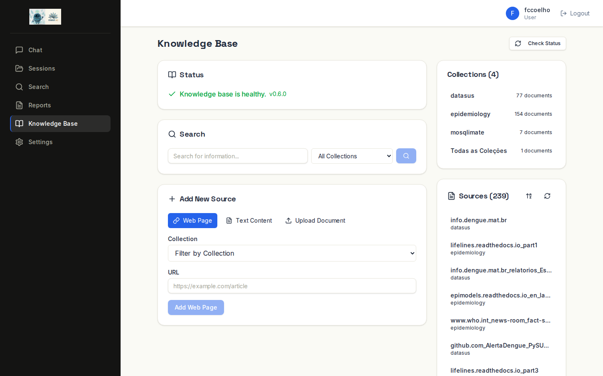

---

## Settings

The settings page lets you manage your profile, security, API access, subscription, and language preferences.

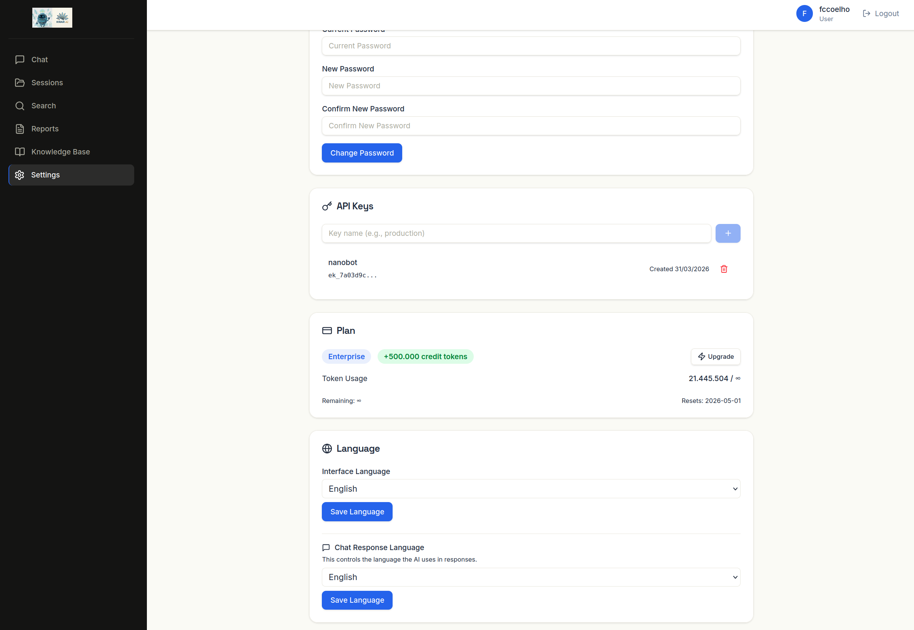

### Profile

Edit your **username**, **email**, and **CPF/CNPJ** (required for payments in Brazil). Click **Update Profile** to save.

### Change Password

Provide your current password and a new password (minimum 8 characters). The new password must be confirmed.

### API Keys

API keys allow programmatic access to EpiDBot's REST API. **Available on the Pro, Max and Team plans** — every paid plan includes API access (see [Subscription Plans & Feature Gating](#subscription-plans--feature-gating)).

API keys are also what the [EpiDBot QGIS plugin](#epidbot-qgis-plugin) uses to run the assistant inside QGIS.

- **Create a key**: Enter a name and click create. The key is shown once — copy it immediately, as it cannot be viewed again.
- **Manage keys**: View existing keys (showing name and prefix), delete keys you no longer need.

### External Agents

External agents are OpenClaw-compatible AI assistants (such as [nanobot](https://github.com/HKUDS/nanobot)) running outside EpiDBot. Once registered, EpiDBot can **send messages to them during a conversation** and relay their responses back to you. This is the reverse of the [EpiDBot skill](https://github.com/openclaw/clawhub) that lets external agents query EpiDBot — it enables EpiDBot to consult *your* agents. **Requires the Max plan or higher (Max or Team).**

#### Registering an Agent

In **Settings > External Agents**, fill in three fields and click **Register Agent**:

| Field | Description | Example |
|-------|-------------|---------|
| **Name** | A unique label for this agent (letters, numbers, spaces, hyphens, underscores; max 100 characters). You will use this name when asking EpiDBot to contact the agent. | `my-nanobot` |
| **Base URL** | The public HTTPS endpoint where the agent is reachable. Must not resolve to a private or loopback IP address (blocked by SSRF protection). | `https://my-agent.example.com` |
| **Bearer Token** | The authentication token EpiDBot will send in the `Authorization: Bearer` header. This is the token your agent's API expects. Stored encrypted in the database. | `sk-abc123...` |

EpiDBot sends messages to your agent using the standard **OpenAI-compatible `/v1/chat/completions` endpoint**. Most agent runtimes (including nanobot's `nanobot serve` command) expose this endpoint by default.

#### Using External Agents

Once registered, you can ask EpiDBot to consult the agent at any time during a conversation:

> *"Consult my agent named my-nanobot and ask: what is the current dengue situation in Southeast Asia?"*

EpiDBot will call the `query_external_agent` tool, which sends your message to the agent's API and returns the reply. You can register multiple agents and address each by name.

#### Managing Agents

- **View** — registered agents appear in a list with their name, URL, and a masked token preview
- **Delete** — click the trash icon to remove an agent; its encrypted token is permanently deleted from the database
- **REST API** — agents can also be managed programmatically via `GET/POST/DELETE /api/v1/external-agents`

#### Security

- Auth tokens are **Fernet-encrypted** at rest using the server's master secret — they are never stored in plaintext
- Outbound requests include only the `Authorization: Bearer <token>` header and a JSON body
- Requests to **private IP ranges** (127.x, 10.x, 172.16–31.x, 192.168.x, link-local) are **blocked** to prevent SSRF attacks

### Git Integrations

Connect your **GitHub** or **GitLab** account in **Settings > Git Integrations** so the agent can work with your repositories from the chat:

- **Read (Pro)**: list repositories, browse files, read file contents, list branches/commits/issues/pull requests, and clone repositories into the session workspace
- **Write (Max)**: create issues, comment on issues, and open pull/merge requests

Personal access tokens are stored encrypted and can be removed at any time.

### Zotero

Connect a **Zotero** API key in **Settings > Zotero** (Pro plan) to let the agent list your Zotero collections, fetch references from your library, and export a report's bibliography straight into Zotero.

### Voice

**Settings > Voice** controls server-side speech features used by voice mode: speech-to-text (transcription) and text-to-speech (spoken responses). Availability depends on deployment configuration (`GET /api/v1/voice/status`); browsers without built-in speech recognition fall back to the server-side transcription service.

### Plan & Consultation Usage

Your plan determines your daily AI quota and which advanced features you can use. Each consultation represents an interaction with the AI (1 consultation = approximately 50,000 tokens of AI processing).

| Plan | Daily Quota | Consultations/day | Price |
|---|---|---|---|
| **Free** | 50,000 tokens | 1 | R$0 |
| **Pro** | 500,000 tokens | 10 | R$97/month |
| **Max** | 1,500,000 tokens | 30 | R$197/month |
| **Team** | Unlimited | Unlimited | R$1,425/month |

For the complete feature-gating matrix and per-plan usage limits (monthly reports, share links, dataset storage, and more), see [Subscription Plans & Feature Gating](#subscription-plans--feature-gating).

- **Current plan badge** — Free, Pro, Max, or Team
- **Usage bar** — shows consultations used vs. limit, color-coded (green < 70%, yellow 70-90%, red > 90%)
- **Reset date** — when your quota refreshes

#### Upgrading Your Plan

1. Click **Upgrade** to open the plan selector
2. Choose between **monthly plans** and **consultation packs**
3. Select a payment method:
   - **PIX** — scan the QR code or copy the PIX code, payment is confirmed automatically
   - **Credit Card** — redirected to a secure payment page
4. Once payment is confirmed, your plan is updated immediately

#### Consultation Packs

Consultation packs are one-time purchases that do not expire. They are consumed after your monthly quota runs out.

#### Academic Discount (50% Off)

Students, faculty and researchers can get **50% off any paid plan**. There are two ways to qualify:

1. **Automatically** — verify an email address on an academic domain (`.edu*`, `.ac.<country>`, e.g. `@fiocruz.br` is detected via email-country, `name@university.edu`, `user@ox.ac.uk`). The discount is applied as soon as the email is verified.
2. **By claiming** — if your email is not on an academic domain, click **"Claim academic discount"** in **Settings > Plan**. Your claim goes to the administrators for review, and you will receive an email once it is approved. The badge shows **"under review"** in the meantime. A verified email address is required to submit a claim.

Once granted, the discount is applied **automatically at checkout** on any plan (Pro, Max, or Team) — no coupon code needed. EpiDBot may also offer an **annual discount** (prepay 12 months upfront); when both qualify, the best single discount applies (they never stack).

### Language Preferences

Two independent language settings:

1. **Interface Language** — controls the UI language (sidebar, buttons, labels)
2. **Chat Response Language** — controls the language EpiDBot uses in its analysis responses

You can, for example, set the interface to English while having EpiDBot respond in Portuguese.

### Newsletter

Subscribe to the **weekly bilingual newsletter** (Portuguese and English editions) with a roundup of public-health publications and data updates, including:

- Ministry of Health publications and new open-data releases from dados.gov.br
- Mosqlimate/InfoDengue updates and WHO Disease Outbreak News
- Health news from curated RSS feeds

Click **Subscribe** in the **Newsletter** card on the Settings page. You will receive a confirmation email and must click its link to activate the subscription (**double opt-in**). You can unsubscribe at any time from the same card or from the link included in every issue. Sent issues are also available in a **web archive**, and per-language **RSS feeds** are linked from the login page. Admins manage the newsletter (schedule, sources, RSS feeds, issues, subscribers, and tips) in **Administration > Newsletter**.

### About

Displays the application version and description.

---

## Subscription Plans & Feature Gating

EpiDBot offers four subscription plans. Your plan determines both your **daily AI usage quota** and which **advanced features** you can access. You can view your current plan, usage, and upgrade at any time in **Settings > Plan**.

### Plans Overview

| Plan | Daily AI Quota | Consultations/day | Price |
|---|---|---|---|
| **Free** | 50,000 tokens | 1 | R$0 |
| **Pro** | 500,000 tokens | 10 | R$97/month |
| **Max** | 1,500,000 tokens | 30 | R$197/month |
| **Team** | Unlimited | Unlimited | R$1,425/month |

*1 consultation ≈ 50,000 tokens of AI processing. Daily quotas reset every day and do not accumulate. Consultation packs (one-time purchases that never expire) are consumed after the daily quota runs out.*

### Discounts

| Discount | Value | How to Qualify |
|---|---|---|
| **Academic** | 50% off any plan | Verified email on an academic domain, or an approved claim (see [Settings > Plan](#settings)) |
| **Annual** | 30% off | Prepay 12 months upfront (single charge) |

Discounts never stack — the best single discount wins, and the academic discount takes precedence when both qualify. See [Academic Discount](#academic-discount-50-off) for the claim workflow.

### Usage Limits by Plan

| Limit | Free | Pro | Max | Team |
|---|---|---|---|---|
| Reports per month | 3 | Unlimited | Unlimited | Unlimited |
| Active share links | 1 | Unlimited | Unlimited | Unlimited |
| Watermark on PDF reports | Yes | No | No | No |
| Scheduled (periodic) reports | — | 2 | 10 | Unlimited |
| Uploaded datasets | 1 | 10 | 50 | Unlimited |
| Dataset storage | 100 MB | 5 GB | 25 GB | Unlimited |

### Feature Gating Matrix

Each feature below requires the listed plan **or higher**. Anything not listed — chat with core DATASUS and WHO data, standard analyses and charts, sandbox code execution, the in-browser IDE, projects, search, session history, report generation within the monthly limit, and the newsletter — is available on **all plans, including Free**.

#### Pro

| Feature | What You Get |
|---|---|
| **Zotero integration** | List Zotero collections, fetch references, and export citations to Zotero |
| **Git integrations** | Read GitHub/GitLab repositories from the chat (issues, PRs, files, clones) |
| **Full web scraping** | Multi-file webpage scraping with JavaScript/headless rendering |
| **All international data sources** | ECDC & ECDC Atlas, World Bank, PAHO, HealthData.gov, ANVISA, Mosqlimate, Pathoplexus, Malaria Atlas, GADM, GBIF, Eurostat, and NZ Health data |
| **Advanced analysis tools** | Causal DAGs, difference-in-differences, interrupted time series, propensity scores, panel regression, multivariate analysis, anomaly detection, decision trees, Markov models, cost-effectiveness, sensitivity analysis, and actuarial modeling (loss reserving, claim models, portfolio aggregation, lifetime models) |
| **Custom report templates** | Upload your own Markdown + CSS report templates |
| **Session sharing** | Unlimited session share links (Free: 1) |
| **Report sharing** | Share reports with other EpiDBot users |
| **Scheduled (periodic) reports** | Automatically generate reports on a daily/weekly/monthly schedule |
| **Project roles** | Role-based access inside projects |
| **Activity feed** | Cross-project activity tracking |
| **Artifact provenance** | Verify the origin and processing history of analyses |
| **Analysis tasks** | Assign analyses as trackable tasks in projects |
| **API keys** | Programmatic access to the EpiDBot REST API (the same keys the QGIS plugin uses) |

#### Max (includes everything in Pro)

| Feature | What You Get |
|---|---|
| **LaTeX export** | Download reports as LaTeX (.tex or ZIP with figures, BibTeX bibliography, and linked analysis code) ready for Overleaf |
| **Report version history** | Browse and restore previous versions of a report |
| **Report co-authoring** | Invite co-authors to collaborate on reports |
| **Overleaf push** | Push reports directly to your Overleaf projects |
| **Zenodo publishing** | Publish reports to Zenodo with a DOI |
| **Public templates** | Publish your report templates for the whole community |
| **Scientific manuscript agent** | AI-assisted manuscript writing with publication-grade Methods sections, numbered equations, and linked analysis code |
| **CRATE enrichment** | Enrich uploaded datasets with CRATE metadata |
| **Wiki query** | Ask questions and get synthesized answers from the KB wiki |
| **KB analyzer / optimizer** | Knowledge base analysis and optimization tools |
| **External agents** | Register and consult external AI agents (e.g. nanobot) |
| **Advanced plots** | Raster and geospatial visualizations (GeoTIFF rendering) |
| **Git write access** | Create issues, comment, and open pull/merge requests |

#### Team (includes everything in Max)

The Team plan includes every Max feature for the whole team, with unlimited usage limits (reports, share links, datasets, scheduled reports — see the table above), plus these **Team-exclusive** collaboration features:

| Feature | What You Get |
|---|---|
| **Team workspaces** | Shared team workspaces with pooled resources |
| **Workspace context (team memory)** | Shared instructions, glossary and decision log per project |
| **Bulk KB embedding** | Embed many documents into the knowledge base in bulk |
| **Report comments** | Threaded comments/annotations on reports |
| **Human review workflow** | Structured peer review of reports before publication |
| **Verification attestation** | Cryptographic attestation of analysis provenance |
| **Incident war-room** | Outbreak coordination: signal claiming and shared timelines |

!!! note "Core data stays free"
    The core Brazilian DATASUS systems (SINAN, SIM, SINASC, SIH/SIA, CNES, PNI, CIHA) and WHO Global Health Observatory indicators remain available on **all plans, including Free**.

### How Gating Works in Practice

- **In the chat** — if you ask for something your plan does not include, EpiDBot explains which plan is required instead of running the tool, and suggests upgrading in **Settings > Plan**
- **In the interface** — gated buttons and cards show a lock badge with the required plan (e.g. "PRO", "MAX") and link to the upgrade page
- **Admins** bypass all feature gates

### Expiry, Grace Period, and Grandfathering

- **Grace period** — if your paid plan expires, you keep full feature access for **7 days** (matching the token-quota grace period). After that, your account reverts to Free-plan behaviour.
- **Grandfathering** — users who already had a paid plan when feature gating was introduced keep access to gated features for **90 days**. Users who upgrade afterwards get plan features immediately per the matrix above.
- **Upgrades are immediate** — once payment is confirmed (PIX or credit card), the new plan's features and quotas apply right away, and new PDF exports no longer carry the Free-plan watermark.
- **Never-expiring plans** — administrators can pin a user's plan so it never expires (the expiry date is ignored entirely). If your plan shows no renewal/expiry date but remains active, this is why — contact your administrator with any questions.

---

## Tips & Best Practices

### Effective Prompting

EpiDBot works best when you are specific about what you want:

| Instead of | Try |
|---|---|
| "Show me data" | "Download SINAN dengue data for Sao Paulo in 2023 and show monthly case counts" |
| "Make a chart" | "Create a bar chart comparing dengue cases across Brazilian states in 2023" |
| "Analyze this" | "Run a temporal analysis of tuberculosis cases by month, broken down by age group" |

### Working with Datasets

- Start by **listing available datasets** to understand what data you can access
- Use **inspect dataset** to see column names and sample data before querying
- For large datasets, filter by year and region to keep queries manageable
- EpiDBot remembers downloaded data within a session — you do not need to re-download

### Analysis Workflow

1. **Explore** — list datasets, inspect schemas
2. **Download** — fetch the data you need
3. **Query** — ask specific questions about the data
4. **Visualize** — generate charts and maps
5. **Report** — compile findings into a PDF report

### Mid-stream Redirection

If EpiDBot is going in a direction you did not intend, simply type a new message while it is processing. The current analysis will be interrupted and a new turn begins.

### Organizing Work with Projects

For anything spanning multiple sessions — a dissertation chapter, an ongoing outbreak investigation — create a [project](#projects) and add your sessions, reports, figures, and datasets to it as you go. You can then share the whole workspace with a colleague in one step instead of sharing items individually.

### Multi-language Analysis

You can ask questions in any language, and EpiDBot will respond accordingly. You can also mix languages within a session — for example, asking in Portuguese and requesting the output in English.

---

## Supported Languages

EpiDBot supports five languages for both the interface and AI responses:

| Language | Interface | AI Responses |
|---|---|---|
| English | Yes | Yes |
| Portugues (Brasil) | Yes | Yes |
| Espanol | Yes | Yes |
| 简体中文 | Yes | Yes |
| العربية | Yes | Yes |

The interface language is set in **Settings > Language** and can also be auto-detected from your browser. The AI response language is set independently in the same section.

---

## Troubleshooting

### Common Issues

| Issue | Solution |
|---|---|
| Chat not responding | Check your internet connection. A "Reconnecting..." banner indicates a WebSocket issue. |
| Plot images not loading | Reload the page. Plot paths may need to be regenerated after long idle periods. |
| "Quota Exceeded" message | You have used your daily token allowance. It resets daily — or upgrade your plan / use a consultation pack. |
| "This feature requires the Pro/Max/Team plan" | The feature is gated to a higher plan. Upgrade in **Settings > Plan** — see [Subscription Plans & Feature Gating](#subscription-plans--feature-gating). |
| PDF has a "FREE PLAN" watermark | Watermarks apply to the Free plan. Upgrade to remove it; exports after upgrading are watermark-free. |
| Data download is slow | Large datasets (e.g., national SINAN data) take time to download. Try filtering by state or year. |
| Sandbox execution fails | The sandbox container may be restarting. Retry after a few seconds. |
| External agent not responding | Verify the agent's URL is reachable from the internet, the Bearer token is correct, and the agent is running. Check that the URL does not resolve to a private IP (blocked by SSRF protection). |
| Language not changing | Clear your browser cookies and reload. The language is stored in the `NEXT_LOCALE` cookie. |
| "This message was not answered" | A previous message failed. Click **Retry** to resend it. |
| Newsletter confirmation email not arriving | Check your spam folder. Your subscription stays "Pending confirmation" until you click the link in the email. Unsubscribe and subscribe again to resend it. |
| IDE code stops after 30 seconds | In-browser execution has a 30-second limit by design. Download the snippet and run it locally for longer jobs. |
| Cannot add items to a shared project | Only project owners and editors can add or remove items. Ask the owner for editor access. |
| EpiDBot QGIS plugin shows "Unauthorized" | Your API key is missing or invalid. Click the **⚙** button in the plugin panel and paste a valid key created in the web UI (**Settings > API Keys**). |
| QGIS plugin cannot reach the server | Check the **Server URL** in the plugin settings (default: `https://api.epidbot.kwar-ai.com.br`) and your network/proxy configuration. Transient network failures are retried automatically. |

### Getting Help

If you encounter an issue not listed here:

1. Check the session history — your previous conversations are always accessible
2. Try starting a new session to isolate the problem
3. Contact the EpiDBot team via the GitHub repository

---

## Glossary

| Term | Definition |
|---|---|
| **DATASUS** | Brazilian Department of Informatics of the Unified Health System — the primary source of Brazilian public health data |
| **SINAN** | Sistema de Informacao de Agravos de Notificacao — Brazil's disease notification system |
| **Parquet** | A columnar storage file format used for efficient data querying |
| **DuckDB** | An in-process analytical database used by EpiDBot to query parquet files |
| **Token** | A unit of AI processing usage. Each message consumes tokens based on length and complexity. |
| **Session** | A conversation thread with EpiDBot. All messages and results are saved within a session. |
| **Knowledge Base** | A collection of embedded documents that EpiDBot can search for relevant information |
| **Dream** | EpiDBot's self-improvement system that analyzes conversations to discover and refine analysis skills |
| **Skill** | A reusable analysis pattern discovered by the Dream system, automatically applied when relevant |
| **Sandbox** | An isolated Docker container for executing Python and SQL code safely |
| **Catalog** | A metadata index of all downloaded datasets, their schemas, and row counts |
| **Raster** | A gridded geospatial data format (e.g., GeoTIFF) used for continuous surface maps |
| **IBGE** | Instituto Brasileiro de Geografia e Estatistica — Brazil's geography and statistics institute |
| **WHO GHO** | World Health Organization Global Health Observatory — a repository of health indicators |
| **ECDC** | European Centre for Disease Prevention and Control |
| **PAHO** | Pan American Health Organization |
| **GADM** | Database of Global Administrative Areas — provides boundary shapefiles |
| **QGIS** | A free, open-source Geographic Information System (GIS). The EpiDBot QGIS plugin lets you chat with EpiDBot and map its results inside QGIS |
| **GeoJSON** | A JSON-based format for encoding geographic features such as points and polygons; the QGIS plugin can turn GeoJSON answers into map layers |
| **PIX** | Brazilian instant payment system used for subscription payments |
| **Voice Input** | Browser-based speech recognition for entering messages by voice |
| **Lightbox** | Full-size image overlay for previewing plots at their natural resolution |
| **User Dataset** | A dataset uploaded by a user (CSV, Excel, GeoJSON, etc.), stored privately and queryable like public data |
| **Version History** | A timeline of saved report versions that can be browsed and restored |
| **Project** | A workspace that links related sessions, reports, figures, and datasets around a common theme, and can be shared as a whole |
| **Pyodide** | Python compiled to WebAssembly — the technology that powers the in-browser code editor (IDE) |
| **Newsletter** | Weekly bilingual (PT/EN) email roundup of public-health publications, datasets, and news |
| **BibTeX** | Bibliography file format used by LaTeX; report exports include a references.bib file |
| **Knowledge Graph** | A network of wiki pages, entities, and concepts built from knowledge base collections, explorable in the Graph view |
| **External Agent** | An OpenClaw-compatible AI assistant (e.g. nanobot) registered by a user, which EpiDBot can send messages to and relay responses from |
| **OpenClaw** | An open agent runtime/platform whose agents can install and invoke "skills" — packaged capabilities described by a SKILL.md manifest |
| **nanobot** | A lightweight, open-source personal AI agent that exposes an OpenAI-compatible `/v1/chat/completions` endpoint for receiving messages |
| **Feature Gate** | A plan-based restriction that limits a feature to a minimum subscription plan (Free < Pro < Max < Team) |
| **Grace Period** | The 7-day window after a paid plan expires during which feature access is retained |
| **Grandfathering** | The 90-day window during which existing paid users keep access to features that became gated |

---

*EpiDBot is developed by Kwar-AI. For technical documentation, visit the [GitHub repository](https://github.com/Deeplearn-PeD/EpiDBot).*
